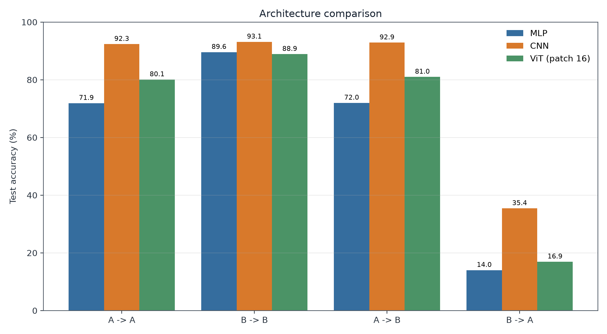

# Translated FashionMNIST

MLP, CNN, and Vision Transformer classifiers trained on FashionMNIST images
placed at controlled positions on a 64 x 64 canvas.

[Report](reports/comparison_study.pdf) ·
[Metrics](results/metrics.csv) ·
[Run record](results/README.md)

## Experiment

Each 28 x 28 image is pasted onto a black 64 x 64 canvas.

- **A (random):** one fixed pseudorandom valid position per sample.
- **B (centered):** every sample at top-left `(18, 18)`.

Each configuration is trained on A and on B. Both checkpoints are evaluated
on A and on B, so each configuration has four scores: A -> A, B -> B,
A -> B, and B -> A.

Three comparisons, six configurations:

1. MLP, CNN, and ViT with patch size 8.
2. ViT patch sizes 4, 8, and 16.
3. Conv2d versus Flatten + Linear patch projection, both at patch size 16.

## Results

| Configuration | Parameters | A -> A | B -> B | A -> B | B -> A |
|---|---:|---:|---:|---:|---:|
| MLP | 542,474 | 71.89% | 89.57% | 71.97% | 13.99% |
| CNN | 205,994 | **92.35%** | **93.14%** | **92.87%** | **35.40%** |
| ViT, patch 4 | 829,834 | 75.28% | 87.22% | 74.97% | 17.02% |
| ViT, patch 8 | 811,402 | 80.40% | 88.27% | 81.13% | 18.81% |
| ViT, patch 16 | 829,834 | 80.07% | 88.87% | 80.97% | 16.91% |
| ViT, patch 16 (Linear) | 829,834 | 79.67% | 88.80% | 80.48% | 16.30% |



Training on A and testing on B moves accuracy by at most 0.90 percentage
points. Training on B and testing on A drops it by 57.74-75.58 points. CNN
is ahead in every column and has the fewest parameters. Among the ViTs,
patch size 8 is ahead on three of the four settings. The two patch-16
projections stay within 0.61 points of each other.

One training seed and one set of placement seeds. Gaps this small are not
a significance claim.

## Setup

From the repository root:

```bash
python -m pip install -r requirements.txt
```

The table above was produced with Python 3.12.13. Pinned versions are in
`requirements-lock.txt`. GPU, CUDA, and the exact protocol are in
`results/manifest.json`.

## Run

Tests:

```bash
python -m unittest discover -s tests -v
```

One-epoch smoke test. Files go to `outputs/`, which is gitignored:

```bash
python -m translated_fashionmnist.experiments.run \
  --groups model \
  --epochs 1 \
  --limit-train-samples 512 \
  --limit-val-samples 128 \
  --limit-test-samples 256 \
  --num-workers 0 \
  --download
```

Full run, same protocol as the recorded numbers:

```bash
python -m translated_fashionmnist.experiments.run \
  --groups all \
  --epochs 15 \
  --batch-size 64 \
  --learning-rate 1e-3 \
  --weight-decay 1e-4 \
  --seed 42 \
  --num-workers 4 \
  --amp \
  --output-dir outputs/formal-reproduction \
  --download
```

| Item | Setting |
|---|---|
| Train / validation | 54,000 / 6,000, split with seed 42 |
| Test | official 10,000-image FashionMNIST test set |
| Optimizer | AdamW, cosine annealing |
| Checkpoint | highest validation accuracy |
| Configurations / fits / test evals | 6 / 12 / 24 |
| Determinism | seeded; deterministic algorithms off |

The test set is used only after the checkpoint is chosen. Every
configuration uses the same split and the same test placements.

Sample canvases (written to `outputs/data_samples.png`):

```bash
python -m translated_fashionmnist.visualize --download
```

Submission zip (report, metrics CSV, and a source archive):

```bash
python tools/build_submission.py
```

Rebuild the PDF from the committed CSVs. This overwrites
`reports/comparison_study.pdf`:

```bash
python reports/build_comparison_report.py
```

## Layout

```text
translated_fashionmnist/   dataset, models, training loop, experiment runner
results/                   metrics, training history, figures, manifest
reports/                   PDF, sample figure, fonts, report builder
tests/
tools/build_submission.py
```

## What this does not show

The models share one training recipe. Parameter counts are not matched, and
nothing was tuned per model. There is no second seed, so there is no error
bar. The only shift is translation on a black canvas.
